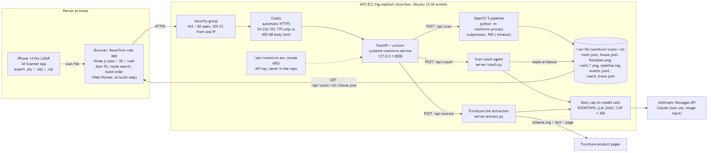
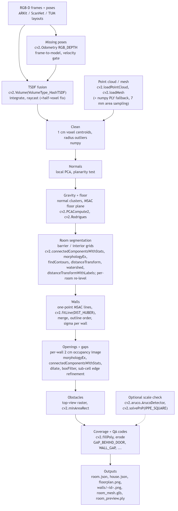
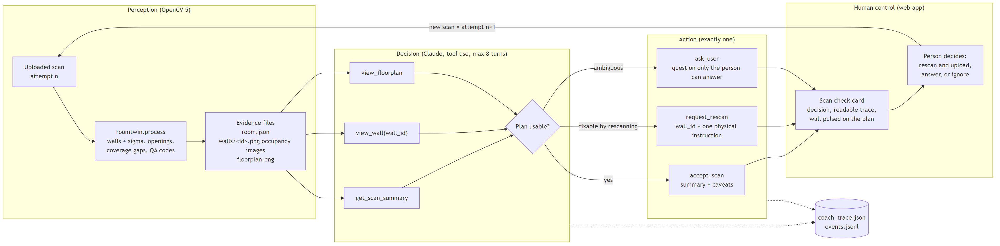
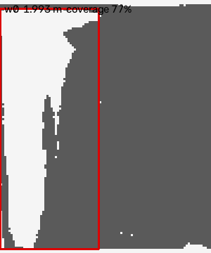
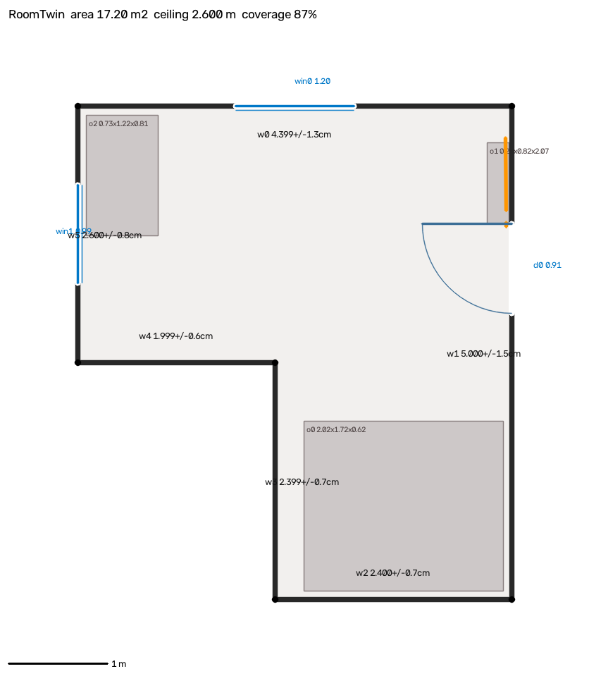
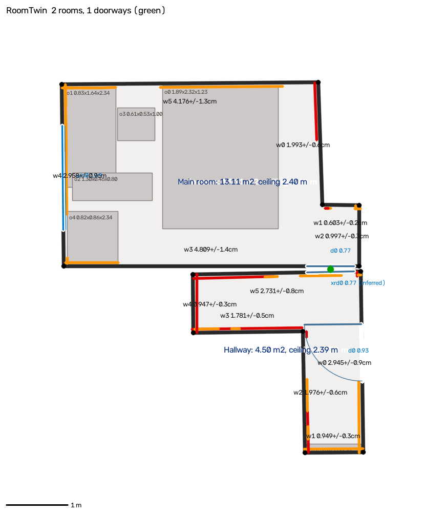

# RoomTwin: technical report

OpenCV AI Competition 2026, powered by AWS. Categories: Overall and the Agentic Vision award.
COOL (the Cloud-Optimized OpenCV Library) is not used in this entry.

Live: https://54-226-102-179.sslip.io/ (AWS EC2 Graviton). Author: Danish Kamboh.

Contents

1. [Problem and users](#1-problem-and-users)
2. [What RoomTwin does](#2-what-roomtwin-does)
3. [Architecture](#3-architecture)
4. [OpenCV 5 implementation](#4-opencv-5-implementation)
5. [OpenCV 5.0.0 binding gaps and bugs found](#5-opencv-500-binding-gaps-and-bugs-found)
6. [The scan coach agent (Agentic Vision)](#6-the-scan-coach-agent-agentic-vision)
7. [AWS deployment](#7-aws-deployment)
8. [Evaluation](#8-evaluation)
9. [Failure cases and limitations](#9-failure-cases-and-limitations)
10. [Responsible use](#10-responsible-use)
11. [Reproducing every number in this report](#11-reproducing-every-number-in-this-report)

---

## 1. Problem and users

Moving house or buying furniture raises the same questions every time. Will this sofa fit against
that wall? Will it go through the bedroom door? Can it get round the hallway corner? In what order
should things go in so nothing blocks anything else? People answer them with a tape measure, a
sketch and guesswork. The mistakes are expensive: a sofa that cannot get through the door, a return
trip, a wardrobe assembled in the wrong room.

LiDAR phones (iPhone Pro, iPad Pro) can capture a room in a minute, and free apps export the result
as a point cloud or mesh. What those exports do not give you is a *measured* model:

* wall lengths you can trust
* the clear width and height of each door
* where the furniture already is
* an honest statement of which parts of the room the phone never saw

Users:

* **People moving or furnishing a home:** check fit and delivery before buying.
* **Renters:** they cannot drill or rebuild, so they plan around what is there.
* **Removalists and delivery staff:** they want to know before the job whether an item fits the
  route, and how to carry it ("tilt it on its side").
* **Accessibility planning:** door clear widths and turning space for a wheelchair or walker are the
  same geometry questions. RoomTwin is not a validated accessibility tool (see section 10).

## 2. What RoomTwin does

1. **Scan and upload.** The person scans a room (or a room plus the hallway behind its door) with a
   LiDAR phone app, then uploads the `.ply` / `.obj` / `.zip` in the web app.
2. **Measure.** The **OpenCV 5 pipeline** on AWS turns the scan into `room.json` / `house.json`:
   * the floor outline, not limited to rectangles
   * walls, each with a length **and a 1-sigma uncertainty**
   * doors and windows with offset, width, sill and height
   * furniture boxes and a coverage score
   * scan-QA findings with concrete actions ("rescan the corner behind the door d0 on w1, from 0.34 m
     to 1.06 m along the wall")
3. **Coach.** The **scan coach agent** looks at that evidence: the summary, the per-wall occupancy
   images and the floor plan the pipeline drew. It then does one of three things: accepts the scan,
   requests one specific rescan, or asks the person a question. The person decides what to do, and a
   rescan becomes attempt 2.
4. **Plan.** The **web app** shows the house as a dimensioned plan, a 3D view and a first-person walk
   mode. Furniture is added from a product link (dimensions extracted on the server, including
   flat-pack box sizes) or from typed sizes. For each item the app:
   * checks door fit over all 6 box orientations plus tilting in the door plane
   * searches for a route from the entry door to the target spot, over position and rotation
     (x, z, yaw)
   * explains where and why the item gets stuck
   * produces a build order: farthest from the entry first, and no item blocks the route or assembly
     space of a later one

## 3. Architecture

### 3.1 System (OpenCV 5 + AWS + agent)

The Mermaid source for this diagram is in [`img/architecture.mmd`](img/architecture.mmd).

| component | path | role |
|---|---|---|
| scan pipeline | `pipeline/roomtwin/` | Python, `opencv-python-headless==5.0.0.93`, `numpy==2.4.6`. Takes a scan; writes `room.json`, `house.json` and images. |
| API server | `server/app.py` | FastAPI: upload, run the pipeline, serve outputs, coach, link extraction, static web app. |
| scan coach | `server/coach.py` | Agent loop over the pipeline's evidence; writes `coach_trace.json`. |
| link extraction | `server/extract.py` | Tries schema.org JSON-LD first, then a dimension regex, then a model reading the page. Every result names its source. |
| web app | `web/` | Static ES modules and three.js 0.160.0 from a CDN, with no build step. Logistics run in a Web Worker. |
| infrastructure | `infra/` | `server-userdata.sh` (first boot) and `deploy.sh` (copy code, write secrets, Caddy, systemd). |

The contract between components is [`SPEC.md`](SPEC.md), which defines the `room.json`, `house.json`
and furniture item formats. The web app works without the server on the bundled samples. Server calls
add features and have fallbacks.

### 3.2 OpenCV 5 pipeline

The Mermaid source is in [`img/pipeline.mmd`](img/pipeline.mmd).

## 4. OpenCV 5 implementation

The pipeline uses OpenCV 5 and numpy, and no other vision library. It takes a point cloud, a mesh or a
folder of RGB-D frames, and never assumes which axis is up. Full detail is in
[`pipeline/README.md`](../pipeline/README.md).

| stage | OpenCV 5 APIs | why |
|---|---|---|
| load | `cv2.loadPointCloud`, `cv2.loadMesh` | The OpenCV 5 3d module reads PLY and OBJ directly. Meshes are sampled by triangle area at 7 mm, because phone meshes are coarse exactly on the flat walls being measured. A numpy PLY reader handles variants the loader rejects. |
| RGB-D fusion | `cv2.VolumeSettings`, `cv2.Volume(VolumeType_HashTSDF)`, `integrate`, `raycast` | Fuses depth frames with known poses into a TSDF. The surface is extracted by raycasting from the input viewpoints (finding 3). HashTSDF is used instead of dense TSDF because of finding 2. |
| missing poses | `cv2.Odometry(OdometryType_RGB_DEPTH)`, `OdometrySettings`, `OdometryFrame`, `prepareFrame`, `compute` | Frame-to-model odometry against the TSDF raycast when no poses are given. With poses it runs as a tracking check. |
| gravity, planes | `cv2.PCACompute2`, `cv2.Rodrigues` | Up-axis candidates come from normal clusters and are scored. The floor plane is found by MSAC (the `SAC_MODEL_PLANE` parametrisation) and refined with a PCA normal. |
| rooms | `connectedComponentsWithStats`, `morphologyEx`, `findContours`, `distanceTransform`, `watershed`, `distanceTransformWithLabels` | Splits a multi-room scan in a top-view image. Barrier pixels separate interior components, and `watershed` on the distance transform is the fallback for a doorway whose lintel was never scanned. `distanceTransformWithLabels` assigns each 3D point to its nearest room, so the two faces of a shared wall go to the rooms they face. |
| walls | `cv2.fitLine(DIST_HUBER)`, `findContours`, `morphologyEx`, `distanceTransform` | MSAC proposes lines; `fitLine` with a Huber loss refits each wall robustly. Contours of the floor image order the walls into a closed outline. |
| openings, gaps | `morphologyEx`, `connectedComponentsWithStats`, `dilate`, `boxFilter` | Each wall becomes a 2 cm occupancy image (dark = scanned). Holes become components, and their type, sill and height come from component statistics. Closed flush doors are found from the door-shaped outline of the gaps around the leaf. |
| obstacles | `connectedComponentsWithStats`, `minAreaRect` | A top-view raster of points between floor and ceiling; components become boxes with an oriented footprint. |
| coverage | `fillPoly`, `erode` | Floor and ceiling rasters inside the outline give the observed fractions. |
| scale check | `aruco.ArucoDetector` (sub-pixel), `solvePnP(SOLVEPNP_IPPE_SQUARE)`, `fillConvexPoly` | An optional independent scale check: the camera-only marker distance from PnP against the LiDAR plane under the marker. |
| outputs | `fillPoly`, `line`, `ellipse`, `putText`, `imwrite` | Dimensioned floor plan and wall images. These images are also the agent's visual evidence. |

### 4.1 Uncertainty per measurement

Every wall carries a `sigma` derived from the least-squares line fit, not a fixed number. Take a
wall fitted to N_eff independent points (occupied 2 x 2 cm cells, so dense correlated sampling is not
over-counted) with perpendicular residual RMS `s`:

    sigma_perp(t)^2 = s^2 / N_eff * (1 + (t - t_mean)^2 / var_t)

A wall's length runs between its intersections with its neighbours, so the neighbours' position
errors propagate through the corner angles. On top of that is a device scale term, 0.3 % by default,
which is an assumption until the ArUco check measures it:

    sigma_L^2 = (sigma_perp,prev(a) / sin phi_a)^2 + (sigma_perp,next(b) / sin phi_b)^2
                + (sigma_perp,own * (|cot phi_a| + |cot phi_b|))^2 + (k_scale * L)^2

The web app shows these on the plan as "4.81 m ± 1 cm", so nobody reads a scan as more exact than it
is.

### 4.2 Scan QA (the agent's structured input)

Every `qa` entry has these fields:

* a severity
* a stable code, such as `GAP_BEHIND_DOOR`, `WALL_GAP`, `WALL_LOW_DENSITY`, `WALL_OCCLUDED`,
  `WALL_INFERRED`, `CORNER_UNSEEN`, `CEILING_PARTIAL`, `SCALE_MISMATCH` or `PIPELINE_FAILED`
* a plain-language message
* an action (`rescan`, `marker` or `ok`)
* a target (a wall and range, a corner, or a surface)

A failed run still writes a `room.json` with a `PIPELINE_FAILED` rescan action, so the agent and the
UI always have something to act on.

## 5. OpenCV 5.0.0 binding gaps and bugs found

Each item was reproduced by a script or a test in `pipeline/tests/`, with
`opencv-python-headless==5.0.0.93`.

1. **`cv::SACSegmentation` and `cv::voxelGridSampling` are not wrapped in Python.** They exist in the
   C++ 3d module, but only the `SAC_MODEL_*` / `SAC_METHOD_*` constants are exposed. Workaround: MSAC
   with the same plane model, refined with `PCACompute2`; voxel downsampling in numpy.
2. **Dense `VolumeType_TSDF` (CPU) applies the camera's world-z translation twice.** A plane at
   z = 2.00 comes out at 2.29. `VolumeType_HashTSDF` is correct and is used instead. A test documents
   this behaviour and will start failing once it is fixed upstream.
3. **`HashTSDF.fetchPointsNormals` returns every voxel in the truncation band**, not the zero
   crossing. Workaround: raycast from the input viewpoints.
4. **`HashTSDF.raycast` surfaces are offset by half a voxel along (+x, +y, −z).** Uncorrected,
   frame-to-model odometry drifts by that offset every frame: 0.40 m after 200 frames. Corrected, the
   drift is 4.5 cm after 200 frames.
5. **`OdometrySettings.setCameraMatrix` requires CV_32F.** Separately, the OpenCL TSDF kernel failed
   with `CL_OUT_OF_RESOURCES` on the development laptop, so the package disables OpenCL.

Items 2 and 4 silently corrupt geometry instead of raising an error. They are written up here so
they can be filed upstream.

## 6. The scan coach agent (Agentic Vision)

### 6.1 Why an agent here

The pipeline produces many QA findings; the real bedroom scan has 15. Most are harmless ("wall
hidden behind the wardrobe from 2.16 m up"). One or two matter for furniture planning: the door, a
long wall with a hole, or a wall that was inferred instead of seen. Deciding which ones matter, and
turning them into one physical instruction a non-expert can follow, needs judgement over both the
numbers and the images. That is the coach's job. It does not measure anything itself.

### 6.2 Workflow: perception → decision → action, with a human in the loop

* **Perception** is entirely the OpenCV 5 pipeline:
  * the `room.json` summary: walls with length, sigma, coverage and an inferred flag; openings;
    ceiling; gaps; QA codes; obstacle sizes
  * the per-wall occupancy images `walls/<id>.png`
  * the dimensioned `floorplan.png`
* **Decision** is Claude (`claude-opus-5-5` through the Anthropic Messages API, strict tool schemas,
  medium effort). It has three read-only tools: `get_scan_summary`, `view_wall(wall_id)` and
  `view_floorplan`. The images are sent as image input, so the model looks at what the scanner saw,
  not only at numbers.
* **Action** is exactly one of `accept_scan(summary, caveats)`,
  `request_rescan(wall_id, instruction, reason)` or `ask_user(question, reason)`.
* **Human control:** the coach runs only when the person presses "Ask the coach", and it changes
  nothing.
  * A rescan request appears in the Scan check card with its reason, and the wall pulses on the plan.
  * The person chooses whether to rescan. A new upload becomes attempt n+1 in the attempt history.

### 6.3 Real trace on the real iPhone scan

File: [`coach_trace_real_bedroom.json`](coach_trace_real_bedroom.json). Input: the iPhone 14 Pro
bedroom and hallway scan (section 8.5). It made 4 tool calls in 20.3 s.

| step | tool | input | result |
|---|---|---|---|
| 1 | `get_scan_summary` | - | room.json summary: 6 walls, coverage 0.907, 15 QA findings |
| 2 | `view_wall` | `{"wall_id": "w0"}` | `walls/w0.png` |
| 3 | `view_floorplan` | - | `floorplan.png` |
| 4 | `request_rescan` | `wall_id: "w0"` | decision recorded |

*`walls/w0.png` from the real scan, the image the agent inspected. The empty wedge at the left end is
the unscanned patch.*

The decision, verbatim:

> **instruction:** "Stand in the middle of the main room, about 2 m back from the short wall on the
> right that runs from the corner by the tall cabinet toward the door alcove (wall w0). Point the
> phone at the corner where that wall meets the long back wall. Sweep slowly from floor to ceiling,
> covering the first metre of the wall out from that corner. Keep the phone moving smoothly and make
> sure the top of the wall near the ceiling is in view. Then finish the scan as usual."
>
> **reason:** "The scan is almost ready. The room's size, the ceiling, the window and the door into
> the hallway were all captured. The door measures 0.77 m wide and 2.07 m high, though the width
> could be off by about 3 cm either way. One spot is missing: the first 0.94 m of wall w0 next to the
> corner, from floor to ceiling, about 1 m² in total. The scanner got no data there at all, and
> nothing was blocking it. The missing patch is wedge-shaped and widest at the top, so it looks like
> the phone just didn't sweep that part. It still needs checking, because that patch could hide a
> radiator, a socket, a recess or an opening, and any of those would change what fits against that
> wall. Every other gap is small or sits behind furniture, which is fine."

How the OpenCV output drove the agent's actions:

* Of 15 QA findings, the summary marked a `WALL_GAP` on w0 with **no occluder**: a 0.94 m gap from
  floor to ceiling. The agent's next tool call was `view_wall("w0")`, not any other wall. The
  pipeline's gap output chose which image it inspected.
* In the image it saw the gap was **wedge-shaped and widest at the top**. From that it concluded a
  missed sweep, not furniture in the way, and that a rescan would fix it.
* It dismissed the other 14 findings (gaps behind furniture, low-density strips) as harmless for
  planning. The final action is `request_rescan` and not `accept_scan`. The door's ±3 cm comes from
  the door sigma in `room.json`. Every number in the reason is from the pipeline.
* The web app then pulses w0 on the plan with "Rescan wall w0".

A second trace, on the synthetic L-shaped room with its door left open, is in
[`coach_trace_lshape.json`](coach_trace_lshape.json). There the agent viewed the door wall, merged two
separate QA rescan actions with an unknown hinge side, and chose "close the door" as the single step
that fixes all three. It also had one flaw: it called the walls' sigma an "error". The system prompt
now states that sigma is a predicted uncertainty, not a measured error.

### 6.4 Evaluation of the agent

**Task success.** There are two recorded end-to-end traces, both correct:

* On a synthetic room with a known injected defect, the agent found the defect.
* On a real scan, it found a real unscanned patch and correctly ignored 14 harmless findings.

**Not yet measured:** a labelled success rate. The protocol is to process every synthetic room with
and without each injected defect (open door, low-density patch, missing ceiling, hidden wall), then
score two things: accept when the room is clean, and rescan the right wall when it is defective.

**Failure handling:**

| failure | handling |
|---|---|
| model never calls an action tool | falls back to `ask` with the model's text, reason `no action tool called` |
| loop runs long | hard limit of 8 model turns |
| wall image missing | the tool says so; the trace records `missing` |
| model unavailable or refuses | requests use the API's server-side fallback model option |
| daily budget used up | HTTP 429 with a plain message; the rest of the app keeps working |
| unknown scan id or path traversal | resolved path must stay under the scans folder, otherwise 404 |
| pipeline failed | `room.json` still has `PIPELINE_FAILED` and a rescan action, so the coach sees the failure as evidence |

**Observability.** Each scan folder holds these files, and the web app renders the trace as readable
steps:

* `events.jsonl`: upload size, processing seconds, wall count, coverage, coach decision, timestamps
* `pipeline.log`
* `coach_trace.json`: every tool call with its input and result, the decision, model, seconds and
  coverage

**Human control.** The agent is advisory. It has read-only perception tools, cannot change a scan, a
measurement or a furniture plan, and cannot start a rescan. Paid model calls are capped per day.

## 7. AWS deployment

| item | value |
|---|---|
| instance | EC2 `t4g.medium` (Graviton, arm64, 2 vCPU, 4 GB), Ubuntu 24.04 arm64, plus 2 GB swap |
| endpoint | https://54-226-102-179.sslip.io/ (sslip.io resolves the name to the instance IP, so Caddy can get a TLS certificate without a purchased domain) |
| HTTPS | Caddy reverse proxy with automatic certificates; 400 MB request body limit |
| app process | `uvicorn app:app` on 127.0.0.1:8000 under systemd (`Restart=always`), as an unprivileged `roomtwin` user |
| data | `/var/lib/roomtwin/scans/<id>/` |
| first boot | `infra/server-userdata.sh` (EC2 user data) |
| deploy | `infra/deploy.sh <ip>`: copy code, venv + pinned pip install, write `/etc/roomtwin.env`, Caddyfile, restart |

**How processing runs.** `POST /api/scan` streams the upload to disk in 1 MB chunks. It unpacks a
`.zip` only after checking that every member path stays inside the scan folder. It then runs
`python -m roomtwin.process` as a subprocess with a 900 s timeout. The OpenCV 5 pipeline runs on the
Graviton CPU using arm64 `opencv-python-headless` wheels. **The real 2.0 M-point iPhone scan
(160 MB) took 12.6 s on the t4g.medium**, from its `events.jsonl`; the same scan takes 19.4 s on the
development laptop.

**Security.**

* No secrets in the repository. The API key is written to `/etc/roomtwin.env` with `umask 077` and
  read by systemd.
* SSH is open from one IP address only, with a key pair. Ports 80 and 443 are public, and the app
  itself listens on localhost only.
* There is a daily cap on model calls (default 300 across the coach and link extraction).
* Uploads go through a type allow-list, a size cap and a zip-slip check, and every file-serving
  route checks paths. Raw uploads are never served back.

Known gaps (not fixed before the deadline):

* The daily counter is held in memory and resets on restart.
* There is no per-client upload rate limit.
* Scans are reachable by link, with no accounts.
* `/api/image` fetches any http(s) image URL; it only returns `image/*` under 8 MB.
* Processing runs inside the upload request on one worker.

## 8. Evaluation

### 8.1 Synthetic rooms with exact ground truth

`roomtwin.synth` generates rectangular, L-shaped, 30°-angled and alcove rooms. Each has a door, a
window, furniture, an open door leaf hiding the wall behind it, a hallway visible through the door,
partial ceiling coverage, a low-density patch, 7 mm noise, 0.2 % outliers, and a random yaw in a y-up
or z-up convention. Ground truth is mapped into the pipeline's own output frame, so a wrong gravity or
yaw estimate would show up as large errors.

| room | walls | max wall error | ceiling error | floor area error | max opening error | furniture IoU |
|---|---|---|---|---|---|---|
| rect (y-up) | 4 | 0.1 cm | 0.0 cm | -0.003 m² | 1.0 cm | 0.934-0.974 |
| lshape (z-up) | 6 | 0.1 cm | 0.0 cm | -0.002 m² | 0.8 cm | 0.945-0.975 |
| angled (y-up) | 5 | 0.1 cm | 0.0 cm | -0.001 m² | 1.3 cm | 0.942-0.967 |
| alcove (z-up) | 8 | 0.4 cm | 0.0 cm | -0.002 m² | 1.4 cm | 0.938-0.977 |

All walls were found with no spurious walls, and the gravity error was 0.000° in every room.

### 8.2 Robustness sweep: 48/48

The sweep runs 4 rooms × 6 seeds × 2 noise levels (5 mm and 10 mm), with random yaw and alternating
y-up / z-up. A scan passes when every wall is within 2 cm, every opening dimension is within 3 cm,
nothing is missing and nothing is extra.

* **Result: 48/48 pass.** The worst wall error was 0.62 cm and the worst opening error 2.29 cm.
* **Re-run after the multi-room changes:** 48/48 again, with the worst opening at 2.30 cm.

### 8.3 Two-room test

The test house is a 4.2 × 3.4 m bedroom and a 5.4 × 1.0 m corridor, with a 12 cm wall between them
and the door open, run over 5 seeds. In every run:

* both rooms were found, and the bedroom was chosen as the primary room
* all walls were within 0.11 cm and the ceilings within 0.06 cm
* the door was found from both sides, paired, and accurate to within 0.95 cm on both sides

### 8.4 Other checks

| test | result |
|---|---|
| 2.3 M-point room | 10.6-11.8 s on a laptop; walls within 0.12 cm |
| RGB-D, 360 frames with poses → HashTSDF | walls within 0.12 cm, openings within 2.2 cm |
| RGB-D, 360 frames, no poses → `cv2.Odometry` | walls within 3.4 cm (drift), openings within 7 cm |
| ArUco scale check | true scale measured as 0.998; a depth scale of 1.020 measured as 1.018 and flagged |
| TUM RGB-D fr1/room (public, Kinect) | qualitative: 4 main walls, window and doorway found; 3 short spurious segments in a cluttered corner |

Automated tests: 33 pipeline tests (pytest) and 20 web tests (door fit, route search, house
transforms, placement), all passing.

### 8.5 Real scan: iPhone 14 Pro, bedroom and hallway

Input: `Room_19_32_48.ply` from the 3d Scanner App, 2,019,282 points, one continuous scan of a
bedroom and the hallway outside its closed door.

**Segmentation.**

* Two rooms were kept: the bedroom (89 % of its rim bounded by wall) and an L-shaped hallway.
* A third region, a view into an unscanned hallway arm with only 21 % of its rim seen, was rejected.
* The bedroom door was closed and flush with the wall. It was found from the door-shaped gap outline
  around the leaf.
* The scan drifts between rooms. The bedroom was re-levelled by 0.97° and the hallway by 0.74°.

Bedroom:

| item | RoomTwin | sigma | inlier RMS | coverage |
|---|---|---|---|---|
| w0 (right wall, upper part) | 1.993 m | 0.60 cm | 0.79 cm | 0.77 |
| w1 (step) | 0.603 m | 0.18 cm | 0.93 cm | 0.87 |
| w2 (right wall, lower part) | 0.997 m | 0.30 cm | 0.92 cm | 0.97 |
| w3 (door wall) | 4.809 m | 1.44 cm | 0.62 cm | 0.97 |
| w4 (window wall) | 2.958 m | 0.89 cm | 0.90 cm | 0.89 |
| w5 (far long wall) | 4.176 m | 1.26 cm | 0.53 cm | 0.71 |
| ceiling height | 2.399 m | 0.72 cm | | |
| door d0 (closed, flush) | 0.768 × 2.074 m | 2.99 cm | | |
| window (behind a blind) | 1.694 m wide, sill 0.926 m | 2.42 cm | | |

Overall coverage was 0.907 and the scan produced 15 QA findings. Across 6 random seeds the bedroom
wall lengths change by at most 0.8 cm.

#### Tape-measure comparison

> **TABLE PLACEHOLDER: tape-measure readings to be added.** error = RoomTwin − tape. The project's
> done-condition is within ±5 cm on 3-4 walls.

| item | tape | RoomTwin | error | sigma | within 2 sigma? |
|---|---|---|---|---|---|
| w0 | _TBD_ | 1.993 m | _TBD_ | 0.60 cm | _TBD_ |
| w1 | _TBD_ | 0.603 m | _TBD_ | 0.18 cm | _TBD_ |
| w2 | _TBD_ | 0.997 m | _TBD_ | 0.30 cm | _TBD_ |
| w3 | _TBD_ | 4.809 m | _TBD_ | 1.44 cm | _TBD_ |
| w4 | _TBD_ | 2.958 m | _TBD_ | 0.89 cm | _TBD_ |
| w5 | _TBD_ | 4.176 m | _TBD_ | 1.26 cm | _TBD_ |
| ceiling | _TBD_ | 2.399 m | _TBD_ | 0.72 cm | _TBD_ |
| door width | _TBD_ | 0.768 m | _TBD_ | 2.99 cm | _TBD_ |
| window width | _TBD_ | 1.694 m | _TBD_ | 2.42 cm | _TBD_ |

Expectation, stated before measuring: on real data `sigma` is likely too small (see 9.2), and
`inlier_rms` is the better indicator of trouble.

## 9. Failure cases and limitations

### 9.1 Observed on real data

* **Inter-room drift of about 1°.** Rooms are measured separately and placed in one frame without
  registering them to each other. The two faces of the shared wall come out 8-14 cm apart instead of
  a constant wall thickness.
* **Ghost layers.** Drift between scanning passes doubles surfaces. The bedroom's short wall shows
  2-3 traces up to 4 cm apart. `sigma` assumes independent noise and does not account for this, so
  real errors can exceed it.
* **Window behind a blind.** The window is measured on the blind, which may not match the glazing. A
  curtain in front of a window turns it into a coverage gap instead.
* **Obstacle boxes are rough.** Furniture boxes are labelled "existing". Anything seen only from the
  front is only as deep as what was seen. Two boxes merge shelving with what is above it.
* **Doors seen from one side only** get an inferred partner with a larger sigma (3.6 cm).
* **Clutter.** On the public TUM scan, a cluttered corner produced short spurious walls. Walls under
  15 cm are now dropped.

### 9.2 Limits of the evaluation

* **Synthetic noise is too kind.** Real LiDAR has range-dependent, correlated noise, multipath in
  corners, and mesh smoothing. The sub-centimetre synthetic errors show the geometry is right; they
  do not predict real accuracy.
* **The real ground truth is the tape table above.** The 0.3 % scale term is an assumption until the
  ArUco check runs on the real phone.
* **The agent has two recorded traces**, not a measured success rate.

### 9.3 Model limits

* **Walls:** must be vertical planes. Sloped ceilings and curved walls are not modelled.
* **Room separation:** needs a lintel or a door-wide constriction; open-plan spaces stay one room.
* **Route search is 2D** (x, z, yaw). It does not plan lifting over obstacles, stairs, or the people
  carrying the item; tilting is considered only at doors. "Fits" means the footprint geometry clears,
  not a guarantee.
* **Door fit:** uses the scanned clear opening with a 2 cm default clearance. The door leaf, handles
  and skirting are not modelled.

## 10. Responsible use

* **Home scans are private data.**
  * On the demo server, scans are stored only to run the demo. They are not shared and not used for
    training, and raw uploads are never served back.
  * Scans are deleted on request.
  * There are no accounts, so anyone with a scan's link can view it.
* **No people or faces are processed.** The pipeline uses geometry only. The coach receives the
  pipeline's summary and its own rendered occupancy images and floor plan, never photos of the room.
* **Consent.** Scan your own space or one you have permission to scan.
* **Uncertainty is shown, not hidden.**
  * Every wall and opening is displayed with its sigma.
  * Inferred walls and doors are marked, and coverage gaps are drawn.
  * The coach is told never to invent measurements.
* **The agent is advisory and bounded.** It runs on request, its tools are read-only, its trace is
  visible, and model calls are capped.
* **Not a certified measurement or accessibility tool.** For building work or compliance, measure
  professionally.
* **Third-party pages.** Link extraction reads one product page per request and labels each result
  with its source ("schema.org", "text pattern", "page read by Claude").

## 11. Reproducing every number in this report

| number | command (from `pipeline/` unless noted) | raw output |
|---|---|---|
| synthetic table (8.1) | `python -m roomtwin.evaluate` | `eval/synthetic_table.md`, `synthetic.json` |
| 48/48 sweep (8.2) | `python -m roomtwin.evaluate --sweep` | `eval/sweep.json` |
| two-room test (8.3) | `python -m pytest -q tests/test_house.py` | test assertions |
| unit tests | `python -m pytest -q tests`; `cd web && node --test tests/doorfit.test.js tests/route.test.js tests/world.test.js` | 33 + 20 tests |
| real scan (8.5) | `python -m roomtwin.process Room_19_32_48.ply -o out/bedroom1` | `room.json`, `house.json` |
| agent traces (6.3) | upload the scan in the web app, then press "Ask the coach" | `docs/coach_trace_*.json` |

The raw iPhone scan (the point cloud) is not in the repository. Its derived floor plan (`web/samples/house_real.json`: wall lengths, openings and furniture boxes, with no photos or location) is included with the author's consent so the live demo works on a real home.
